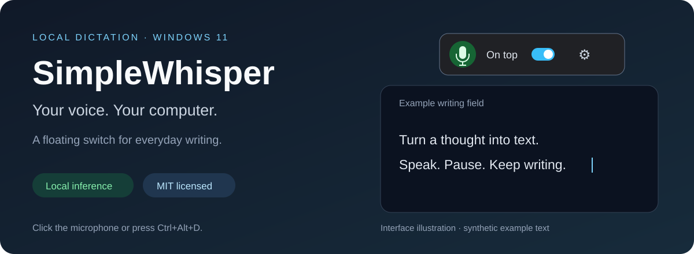
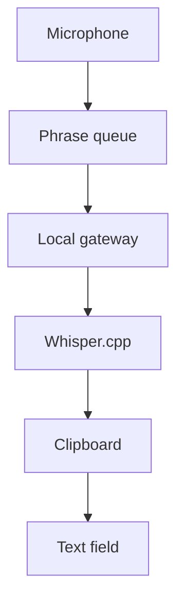

# SimpleWhisper

**Local voice dictation for Windows. A floating microphone switch that stays out of your way.**

[**Download 0.5.2**](https://github.com/Mtolson415/local-whisper-dictation/releases/tag/v0.5.2) · [**Get started**](docs/GETTING-STARTED.md) · [**Get help**](https://github.com/Mtolson415/local-whisper-dictation/issues/new/choose) · [**Contribute**](CONTRIBUTING.md)

## Speak into the app you already use

Click your text field, turn on the microphone, and speak. SimpleWhisper recognizes a phrase after a short pause and inserts it into the active external field. Turn listening off when you finish.

| Everyday use | What you get |
| --- | --- |
| A floating toolbar | Microphone button, independent **On top** switch, and settings |
| Your choice of shortcut | **Ctrl+Alt+D** by default; configurable in Settings |
| Local recognition | Whisper.cpp in Docker, without a cloud inference fallback |
| English and Spanish | Multilingual **Base** default; **Base.en** and **Turbo** alternatives |
| Explicit microphone control | Starts off; no automatic listening timeout |
| A clean exit | Closing stops the two owned containers and app helper |

**Requires Windows 11 x64, Docker Desktop with Linux containers, and external model files.** The portable download includes the Windows runtime; models are separate. The executable is unsigned.

## Get started

1. [Download and extract the Windows ZIP](https://github.com/Mtolson415/local-whisper-dictation/releases/tag/v0.5.2).
2. Follow [setup](docs/GETTING-STARTED.md) to obtain models and configure your private `.env`.
3. Start Docker Desktop, then run `Start-Dictation.ps1`. Preparation took around 30 seconds on a previously checked system; initial downloads can take longer.
4. With listening off, choose your microphone/model in Settings. Click an external field and press **Ctrl+Alt+D**.
5. Speak, pause and review the text. Switch listening off when finished.

Green means capture enabled; red means off. Green does not prove recognition or insertion succeeded. Already-recorded audio may finish recognition after stopping. No Enter key is sent.

<strong>How does speech reach my text field?</strong>

Phrases end at roughly 0.6 seconds of quiet or eight seconds of speech. Stale results are discarded after detected destination/session changes. Keep focus steady: native handles cannot distinguish every logical field inside a browser window.

<strong>Privacy and clipboard behavior</strong>

Inference uses loopback-only local containers. The app saves no recordings or transcript history. Initial downloads require internet access; fully disconnected operation has not been independently accepted. Insertion overwrites clipboard contents. Windows clipboard history/sync are separate settings. Whisper logs may contain recognized text: keep them private. [Security and privacy →](SECURITY.md)

<strong>No window or no text? Start here.</strong>

Run `Start-Dictation.ps1` from PowerShell for visible errors. Check Docker Desktop, models and microphone choice. Test an ordinary scratch field and read the toolbar status. Protected/elevated apps may reject input. [Troubleshooting →](docs/README.md#troubleshooting)

## Release status

**0.5.2** is current. The owner reported on November 12, 2026 that they tested it and it works; applications, duration and language coverage were not specified. Automated Windows/Linux checks cover gateway, segmentation, preferences and input/lifecycle guards. Earlier owned-window and packaged-lifecycle results are in the [handoff](HANDOFF.md); hosted checks are linked above.

Recognition can mishear or hallucinate. Review text before sending. Universal app compatibility, password/elevated fields, prolonged use, reboot/offline operation and second-host recovery are not established. See the [release checklist](docs/RELEASE-CHECKLIST.md) for v1.0 acceptance.

## Explore and contribute

- [Build/setup](docs/GETTING-STARTED.md) · [Operating guide](docs/README.md) · [Changelog](CHANGELOG.md)
- [Contributing](CONTRIBUTING.md) · [Code of conduct](CODE_OF_CONDUCT.md) · [Security](SECURITY.md)
- [Presentation research](docs/PROJECT-PRESENTATION.md) · [Implementation review](docs/IMPLEMENTATION-REVIEW.md)
- [Repository map](docs/REPOSITORIES.md) · [Maintainer handoff](HANDOFF.md)

Maintained by [Michael Tolson](https://github.com/Mtolson415). Original source is [MIT licensed](LICENSE). Dependencies retain their upstream licenses; weights are not bundled. [Third-party notices](THIRD_PARTY_NOTICES.md).
