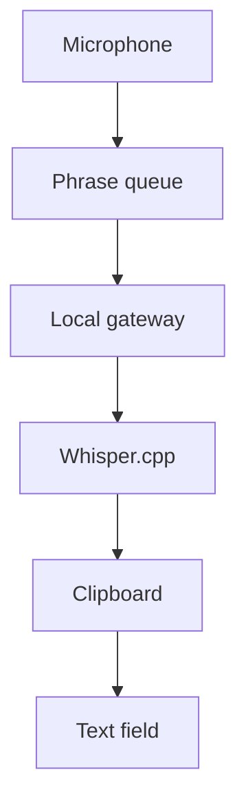

# SimpleWhisper

**Local voice dictation for Windows. A floating microphone switch that stays out of your way.**

[**Download 0.5.2**](https://github.com/Mtolson415/SimpleWhisper/releases/tag/v0.5.2) · [**Get started**](docs/GETTING-STARTED.md) · [**Get help**](https://github.com/Mtolson415/SimpleWhisper/issues/new/choose) · [**Contribute**](CONTRIBUTING.md)

## Speak into the app you already use

Click your text field, turn on the microphone, and speak. SimpleWhisper recognizes a phrase after a short pause and inserts it into the active external field. Turn listening off when you finish.

| Everyday use | What you get |
| --- | --- |
| A floating toolbar | Microphone button, independent **On top** switch, and settings |
| Your choice of shortcut | **Ctrl+Alt+D** by default; configurable in Settings |
| Local recognition | Whisper.cpp in Docker, without a cloud inference fallback |
| English and Spanish | Multilingual **Base** default; **Base.en** and **Turbo** alternatives |
| Explicit microphone control | Starts off; no automatic listening timeout |
| A clean exit | Closing stops the two owned containers and app helper |

**Requires Windows 11 x64, Docker Desktop with Linux containers, and external model files.** The portable download includes the Windows runtime; models are separate. The executable is unsigned.

Current source/local build **0.5.3** adds a dark startup checklist, smooth microphone and pin-switch artwork with hover feedback, and removal of recognition-generated ellipses during pauses. The download link above remains the published 0.5.2 release until a new release is published.

## System requirements

| Component | Requirement |
| --- | --- |
| Windows | Windows 11 x64, ordinary signed-in desktop session; use a Windows edition/build supported by your Docker Desktop installation |
| Processor | 64-bit x86 processor with hardware virtualization enabled and SLAT support for the Docker/WSL backend; speech runs on the CPU |
| Memory | Docker documents an 8 GB system RAM minimum. 16 GB or more is practical headroom for Windows, Docker and other apps; this is guidance, not a benchmarked SimpleWhisper minimum |
| Docker | Docker Desktop configured for **Linux containers**, with a working WSL 2 backend (or supported Hyper-V setup), Compose v2 and the `docker desktop start` command available |
| Disk | Base and Base.en are about 141 MiB each; optional Turbo is about 1.51 GiB. All three total about 1.79 GiB, plus the app, Docker images/build cache and Docker's virtual disk. Keep several additional GB free |
| Microphone | A working Windows input device, with microphone access allowed for desktop apps |
| Launcher | Built-in Windows PowerShell 5.1 and .NET/WPF. The installed shortcut sets RemoteSigned for its own process; managed organization policies still apply |
| Network/setup | Internet is needed to obtain Docker, app dependencies/images and model files. Recognition uses local services after setup; full disconnected/reboot acceptance is not yet verified |
| Local configuration | External model folder configured in `.env`; loopback ports **17863** and **18081** available |
| Development only | Python 3.14 and the pinned source/build requirements. The portable companion includes Python; end users do not install it separately |

Docker's host prerequisites are maintained in its [Windows installation requirements](https://docs.docker.com/desktop/setup/install/windows-install/). Model sizes come from this project's [model manifest](models.lock.json). No dedicated GPU or cloud speech API key is required by this CPU configuration.

After one-time setup, **double-click SimpleWhisper**. A compact dark checklist appears while the launcher checks the app, starts Docker Desktop, waits for the speech model and dictation service, and opens the toolbar. You do not need to start Docker manually. Successful steps turn green; the active step is blue. The window closes after the toolbar responds. If startup fails, the failed step and selectable error details stay visible. The microphone always starts off.

## Get started

1. [Download and extract the Windows ZIP](https://github.com/Mtolson415/SimpleWhisper/releases/tag/v0.5.2).
2. Follow [setup](docs/GETTING-STARTED.md) to obtain models and configure your private `.env`.
3. Run `Start-Dictation.ps1` or use the installed desktop shortcut. It starts Docker Desktop and displays a checklist while services prepare; initial downloads can take longer.
4. With listening off, choose your microphone/model in Settings. Click an external field and press **Ctrl+Alt+D**.
5. Speak, pause and review the text. Switch listening off when finished.

Green means capture enabled; red means off. Green does not prove recognition or insertion succeeded. Already-recorded audio may finish recognition after stopping. No Enter key is sent.

<strong>How does speech reach my text field?</strong>

Phrases end at roughly 0.6 seconds of quiet or eight seconds of speech. Stale results are discarded after detected destination/session changes. Keep focus steady: native handles cannot distinguish every logical field inside a browser window.

<strong>Privacy and clipboard behavior</strong>

Inference uses loopback-only local containers. The app saves no recordings or transcript history. Initial downloads require internet access; fully disconnected operation has not been independently accepted. Insertion overwrites clipboard contents. Windows clipboard history/sync are separate settings. Whisper logs may contain recognized text: keep them private. [Security and privacy →](SECURITY.md)

<strong>No window or no text? Start here.</strong>

Run `Start-Dictation.ps1` from PowerShell for visible errors. Check Docker Desktop, models and microphone choice. Test an ordinary scratch field and read the toolbar status. Protected/elevated apps may reject input. [Troubleshooting →](docs/README.md#troubleshooting)

## Release status

**0.5.2** is the published release; **0.5.3** is the current source/local build. Earlier owned-window and packaged-lifecycle results are in the [handoff](HANDOFF.md); hosted checks are linked above.

Recognition can mishear or hallucinate. Review text before sending. Universal app compatibility, password/elevated fields, prolonged use, reboot/offline operation and second-host recovery are not established. See the [release checklist](docs/RELEASE-CHECKLIST.md) for v1.0 acceptance.

## Explore and contribute

- [Build/setup](docs/GETTING-STARTED.md) · [Operating guide](docs/README.md) · [Changelog](CHANGELOG.md)
- [Contributing](CONTRIBUTING.md) · [Code of conduct](CODE_OF_CONDUCT.md) · [Security](SECURITY.md)
- [Presentation research](docs/PROJECT-PRESENTATION.md) · [Implementation review](docs/IMPLEMENTATION-REVIEW.md)
- [Repository map](docs/REPOSITORIES.md) · [Maintainer handoff](HANDOFF.md)

Maintained by [Michael Tolson](https://github.com/Mtolson415). Original source is [MIT licensed](LICENSE). Dependencies retain their upstream licenses; weights are not bundled. [Third-party notices](THIRD_PARTY_NOTICES.md).
